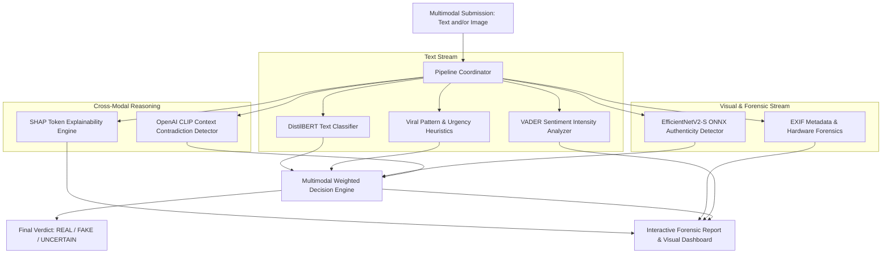

# DEEPGUARD: Context-Aware Multimodal Misinformation Detection with Explainable AI

[](https://www.python.org/)
[](https://flask.palletsprojects.com/)
[](https://pytorch.org/)
[](https://huggingface.co/)
[-brightgreen.svg)](benchmark_100/)

> **DeepGuard** is an end-to-end multimodal artificial intelligence system designed to detect, analyze, and explain synthetic, manipulated, and sensationalist misinformation across online posts comprising both text claims and visual images.

---

## 🏛 System Architecture

DeepGuard orchestrates 7 specialized AI sub-modules linked to a central Multimodal Fusion Engine:



---

## 📂 Repository Structure

```text
DEEPGUARD/
├── backend/                  # Flask application server, controllers, and services
│   ├── instance/             # SQLite active database (deepguard.db)
│   ├── static/               # CSS design tokens, modern themes, brand assets, JS
│   ├── templates/            # 13 Jinja2 HTML web interface views
│   ├── deepguard_distilbert/ # Production DistilBERT transformer weights
│   ├── app.py                # Main Flask application & REST API router
│   ├── database.py           # SQLAlchemy database initialization
│   ├── models.py             # User, Prediction, Notification, PasswordReset models
│   ├── metadata_analysis.py  # EXIF camera forensics engine
│   ├── viral_analysis.py     # Sensationalism & urgency heuristics
│   └── xai_analysis.py       # SHAP word-level explainability service
│
├── frontend/                 # Client-side UI architecture documentation & catalog
├── modules/                  # 7 Standalone AI detection modules
│   ├── text_analysis/        # DistilBERT text classification engine
│   ├── image_detection/      # EfficientNetV2-S fine-tuned ONNX detector
│   ├── context_mismatch/     # CLIP ViT-B/32 cross-modal contradiction detector
│   ├── viral_pattern/        # Emotional urgency and clickbait detector
│   ├── metadata/             # EXIF parsing & hardware consistency module
│   ├── sentiment/            # VADER polarity scoring module
│   ├── shap_xai/             # Feature attribution & token explanation
│   ├── fusion_engine/        # Weighted multi-stream decision engine
│   ├── pipeline.py           # Unified execution coordinator
│   └── explanation_generator.py # Natural language human-readable explanation generator
│
├── database/                 # Database schema definitions and inspection tools
│   ├── schema.sql            # Full SQL DDL with constraints and indexes
│   ├── db_status.py          # Database health and record count utility
│   └── README.md             # Entity-Relationship diagram and table documentation
│
├── datasets/                 # Benchmark text corpora (WELFake, LIAR, COVID-19, FakeNewsNet)
├── data/                     # Multimodal context mismatch image repository
├── models/                   # Active and historical deep learning models & weights
├── notebooks/                # Exploratory Data Analysis & training Jupyter notebooks
├── benchmark_100/            # 44-case QA verification test suite and latency benchmarks
└── docs/                     # Academic proposals, SRS documentation, and architecture charts
```

---

## 🚀 Quick Start Guide

### 1. Prerequisites
- Python 3.10+
- Activated environment: `deepguard_env`

### 2. Launch the Application
```bash
# Navigate to the backend directory and run:
python backend/app.py
```
Open your web browser at **`http://127.0.0.1:5000`**.

### 3. Run the Automated 44-Test QA Suite
```bash
python benchmark_100/deepguard_qa_tests.py
```

### 4. Check Database Status
```bash
python database/db_status.py
```

---

## 🧪 Comprehensive QA Verification Suite

DeepGuard includes an automated 44-point Quality Assurance test suite:

| Category | Cases | Result |
|---|:---:|:---:|
| **Smoke Tests** (Core Route Availability) | 9 / 9 | 100% PASS |
| **Functional Tests** (AI Modules & Pipeline) | 11 / 11 | 100% PASS |
| **Boundary & Edge Cases** (Long text, Unicode, >10MB) | 6 / 6 | 100% PASS |
| **Security Tests** (XSS, SQLi, Auth Guarding) | 5 / 5 | 100% PASS |
| **Performance Latency** (ONNX, DistilBERT, Concurrency) | 7 / 7 | 100% PASS |
| **Regression Tests** (Post-Upgrade Integrity) | 6 / 6 | 100% PASS |
| **TOTAL** | **44 / 44** | **100.0% PASS** |
