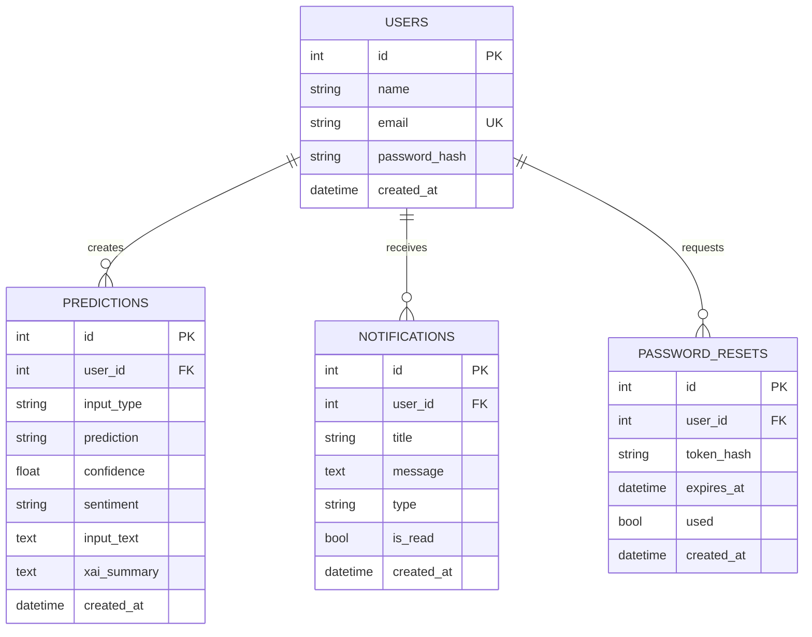

# DeepGuard Database Architecture

This directory defines the relational database architecture and schemas for the DeepGuard Multimodal Detection System.

## Database Engine
- **Engine:** SQLite 3
- **ORM:** SQLAlchemy via Flask-SQLAlchemy
- **Active Instance Path:** `backend/instance/deepguard.db`

---

## Schema Overview

The database contains 4 relational tables:



---

## Files in this Directory

| File | Purpose |
|---|---|
| [`schema.sql`](schema.sql) | Complete DDL script for table creation, constraints, and indexes. |
| [`db_status.py`](db_status.py) | Python utility to check table row counts and verify database integrity. |

## Quick Health Check
Run the inspection utility from anywhere:
```bash
python database/db_status.py
```
