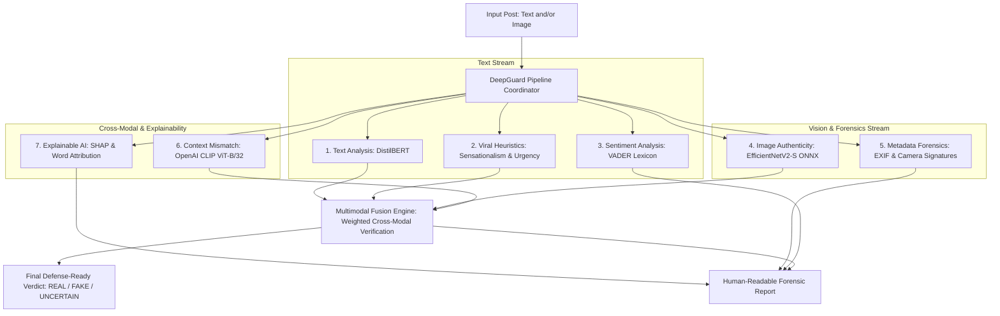

# DeepGuard Modular AI Engine Architecture

DeepGuard orchestrates 7 specialized AI sub-modules through a centralized unified pipeline ([`pipeline.py`](pipeline.py)) to deliver comprehensive multimodal fake news detection.

---

## Module Index

| # | Directory | Core Technology | Primary Function |
|---|---|---|---|
| **1** | [`text_analysis/`](text_analysis/) | Fine-Tuned DistilBERT | Deep contextual semantic fake claim classification. |
| **2** | [`image_detection/`](image_detection/) | EfficientNetV2-S (ONNX) | AI-generated & synthetic artifact image detection. |
| **3** | [`viral_pattern/`](viral_pattern/) | Heuristic Pattern Engine | Emotional urgency, engagement clickbait, and panic markers. |
| **4** | [`context_mismatch/`](context_mismatch/) | OpenAI CLIP ViT-B/32 | Semantic alignment & context contradiction verification. |
| **5** | [`metadata/`](metadata/) | EXIF Parsing Engine | Hardware consistency, GPS, timestamps, and camera tags. |
| **6** | [`sentiment/`](sentiment/) | VADER Intensity Lexicon | Polarity scores, emotional charge, and tone metrics. |
| **7** | [`shap_xai/`](shap_xai/) | Kernel SHAP / Attribution | Word-level contribution highlighting for transparency. |
| **8** | [`fusion_engine/`](fusion_engine/) | Weighted Decision Engine | Dynamic multi-source scoring with cross-modal override rules. |

---

## Coordinator & Human Explanations

* **[`pipeline.py`](pipeline.py)**: Central controller (`run_deepguard_analysis`) that coordinates all sub-modules, handles graceful fallbacks for missing modalities, and aggregates outputs.
* **[`explanation_generator.py`](explanation_generator.py)**: Generates intuitive, non-technical natural language explanations summarizing the evidence for the end-user.
